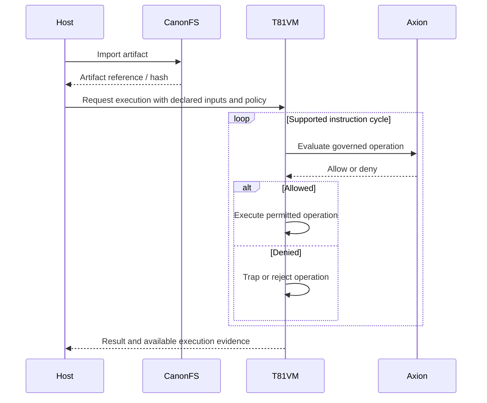

# T81 Foundation — A Systems Research Project in Computational Objects

**Deterministic execution · Content-addressed artifacts · Explicit governance · Representation-independent interfaces**

<p align="center">
  
</p>

[English](./README.md) | [简体中文](./README.zh-CN.md) | [Español](./README.es.md) | [Русский](./README.ru.md) | [Português](./README.pt-BR.md)


[](https://deepwiki.com/t81dev/t81-foundation)

T81 Foundation is an experimental computing substrate for investigating how computational artifacts can be identified, inspected, governed, composed, and executed across different representations and execution environments.

The repository provides a concrete starting point: a virtual machine and instruction set, content-addressed storage, policy-enforcement mechanisms, language tooling, deterministic computation facilities, and interfaces for importing and inspecting model artifacts.

These components support a broader research question:

> **Can different kinds of computational objects share stable system interfaces without erasing the differences between their representations, capabilities, and execution requirements?**

T81 does not assume that this question has a single obvious answer. The project investigates it through implementations, executable contracts, controlled experiments, benchmarks, and documented limitations.

The existing runtime is an experimental foundation—not a predetermined architecture for every future computing system.

## 1. Research direction

Most computing systems distinguish between data, programs, models, execution engines, and operating-system services. Those distinctions are useful, but they also create boundaries where identity, capabilities, execution requirements, permissions, and provenance must be translated or reconstructed.

T81 explores whether a more explicit computational-object model can make these relationships easier to inspect and manage.

A computational object might be a model, tensor, program, policy, decision, evidence record, or another artifact with a defined representation and contract. Objects need not share a file format, internal structure, or execution mechanism to participate in a common system.

The central hypothesis is that **stable object identity and explicit capabilities can provide a useful interface across changing representations and execution implementations**.

This is a research hypothesis, not an established result.

### Questions under investigation

- **Identity:** What should identify an object when its representation changes but its logical role remains the same?
- **Inspection:** What can a system determine about an object before loading or executing it?
- **Capabilities:** How should an object declare what operations it supports and what resources those operations require?
- **Execution:** Can one object interface accommodate different virtual machines, inference engines, CPU implementations, and accelerators?
- **Representation:** When are binary, balanced-ternary, symbolic, or learned representations meaningfully interchangeable?
- **Governance:** Where should authorization and policy checks occur, and what evidence establishes that they cannot be bypassed within a defined execution path?
- **Reproducibility:** Which properties can be reproduced exactly, under what environmental constraints, and which cannot?
- **Composition:** Can objects be connected into larger computations while preserving identity, constraints, and evidence about the resulting execution?

These questions should shape the architecture through evidence rather than dictate its answers in advance.

## 2. What exists today

T81 already contains several concrete systems components. Their presence does not establish every system-wide property attributed to them; the implementation, contracts, tests, and documented limitations determine what can reasonably be claimed.

| Component | Intended role | Evidence and scope |
|---|---|---|
| **TISC ISA** | Instruction set for T81 execution | ISA v1.9.0 is designated frozen by the project. See the canonical specifications. |
| **T81VM** | Executes supported TISC programs | Inspect the implementation, execution contracts, and tests to establish supported behavior. |
| **Axion** | Applies policy and governance rules at defined execution boundaries | Evaluate enforcement through implementation paths, denial tests, and explicit side-effect boundaries. |
| **CanonFS** | Content-addressed storage and artifact retrieval | Test import, identity, export, integrity checks, and policy-controlled operations. |
| **T81Lang** | Language tooling for T81 programs and ternary-oriented computation | Evaluate supported syntax, compilation, execution, and conformance against the current implementation. |
| **Model artifact intake** | Recognizes and inspects supported model formats and tensor inventories | Distinguish format recognition and metadata extraction from model loading, inference, or semantic equivalence. |
| **Determinism facilities** | Provide controlled execution and reproducibility mechanisms | Establish the applicable input, environment, numeric, platform, and output constraints from the relevant contracts and tests. |

The repository also contains experimental research outside the deterministic core. Such work should not automatically inherit the maturity, security properties, or reproducibility claims of the core components.

For current status and authoritative definitions, consult the [system status](docs/status/SYSTEM_STATUS.md), [project boundaries](docs/PROJECT_BOUNDARIES.md), and [determinism surface registry](docs/governance/DETERMINISM_SURFACE_REGISTRY.md).

## 3. Architectural principles

The project follows five working principles.

### 3.1 Evidence before architecture

An appealing abstraction is not evidence that the abstraction is useful. Architectural proposals should be evaluated against working alternatives, representative workloads, explicit requirements, and reproducible results.

### 3.2 Representations remain plural

Balanced ternary is one research direction, not a requirement that every object or computation use ternary encoding.

Binary formats, conventional numeric types, symbolic representations, learned representations, and ternary encodings should be compared where the comparison is meaningful. A representation earns its place through demonstrated benefits for a defined workload.

### 3.3 Interfaces should outlive implementations

A useful object contract should not unnecessarily depend on a particular file format, inference engine, VM, or device.

However, abstraction must not conceal important differences. Precision, quantization, supported operations, resource requirements, execution semantics, and security boundaries must remain visible wherever they affect correctness.

### 3.4 Governance is distinct from correctness

A computation can be authorized but incorrect. An artifact can have a valid cryptographic identity but contain false information. A deterministic decision can be consistently reproduced and still be unjustified.

T81 therefore treats artifact integrity, execution authorization, reproducibility, and the validity of a result as distinct properties requiring different evidence.

### 3.5 Failure is a research result

Failed experiments, unsupported formats, performance regressions, abstraction leaks, portability failures, and unsuccessful hardware integrations are valuable findings.

They should be recorded rather than hidden behind maturity labels or replaced with unsupported claims of generality.

## 4. System architecture

The existing implementation provides several mechanisms that can support experiments in computational objects. The following is a way to understand their roles, not a claim that a complete, universal object architecture has already been implemented.

### Artifact identity and storage

CanonFS provides content-addressed artifact storage. Cryptographic identity can help detect changes to stored content and establish references between artifacts.

Content addressing alone does not establish the origin, truth, safety, or authorization of an artifact. Those properties require additional evidence and policies.

### Execution

T81VM and the TISC instruction set define one execution environment. The relevant contracts establish what instructions, types, and execution behaviors are supported.

A future object abstraction may need to accommodate execution providers beyond T81VM. Whether this can be accomplished without sacrificing useful guarantees is an open question.

### Policy enforcement

Axion provides policy-enforcement mechanisms for defined operations and execution paths.

The important research boundary is not simply whether a policy engine returns an allow or deny verdict. It is whether the protected operation is actually prevented before the relevant side effect when authorization fails. That claim must be established for each covered path.

### Model artifacts

Model formats such as GGUF and Safetensors describe artifacts with different conventions and metadata. Importing a model artifact is not equivalent to executing it.

A useful object interface should expose what is known about an imported artifact, what remains unknown, and which operations are supported by available execution providers.

### Provenance and evidence

Execution inputs, transformations, policy decisions, outputs, and verification results can be represented as linked artifacts where supported.

The objective is to make the basis of a result inspectable without confusing recorded provenance with proof that the result is factually or normatively correct.

## 5. Current execution workflow

The following sequence illustrates the intended relationship between artifact storage, policy enforcement, and VM execution. Actual enforcement guarantees depend on the implemented path and its contracts.



This diagram is conceptual. It does not establish that every instruction, host operation, storage operation, or external side effect passes through an identical enforcement path.

## 6. Try T81

The following instructions reflect the repository paths and commands documented for the current project. Run them from a clean checkout and consult the relevant documentation if a command, artifact, or dependency has changed.

### 6.1 Build and run tests

Requirements include Git, CMake, a compatible C++ toolchain, and Ninja if using the generator shown below.

```bash
git clone https://github.com/t81dev/t81-foundation.git
cd t81-foundation

cmake -B build -G Ninja -DCMAKE_BUILD_TYPE=Release
cmake --build build
ctest --test-dir build --output-on-failure
```

Relevant CMake options documented by the project include:

- `T81_STRICT_DETERMINISTIC_FLOAT=ON` — enables the configured strict deterministic floating-point paths.
- `T81_BUILD_EXAMPLES=ON` — builds the checked-in C++ examples.

Check the current CMake configuration and determinism documentation for supported options and their exact scope.

### 6.2 Try the Docker demonstration

```bash
docker run --rm -it ghcr.io/t81dev/t81-foundation demo
```

The documented demonstration covers a hello-world example, a ternary demo, determinism verification, and an interactive REPL.

This requires access to the published image and assumes the image's `demo` command remains available.

### 6.3 Demonstrate CanonFS import, export, and policy denial

The following example uses the repository's documented sample artifact and denial policy.

```bash
tmp_root="$(mktemp -d)"
canon_root="$tmp_root/.t81_canonfs"
artifact="examples/storage-and-canonfs/canonfs-interchange/v1/model.t81w"
deny_policy="examples/storage-and-canonfs/canonfs-interchange/v1/policy-deny-all.apl"

# Import the artifact.
./build/t81 canonfs import \
  "$artifact" \
  --canonfs-root "$canon_root" \
  --json

# Capture the artifact's content-addressed reference.
canon_hash="$(
  ./build/t81 canonfs import \
    "$artifact" \
    --canonfs-root "$canon_root" \
    --json |
  grep -o '"hash": "[^"]*"' |
  head -n 1 |
  cut -d'"' -f4
)"

# Export the artifact by reference.
./build/t81 canonfs export \
  "$canon_hash" \
  --canonfs-root "$canon_root" \
  --out "$tmp_root/restored.t81w" \
  --json

# Attempt an import under a denying policy.
./build/t81 canonfs import \
  "$artifact" \
  --canonfs-root "$canon_root" \
  --policy "$deny_policy" \
  --json
```

The documented expected behavior is successful import and export, followed by a policy-denial result for the final operation.

To validate the demonstration, check the returned status and error fields, compare the original and exported artifact bytes, and examine the storage state before and after the denied operation. A denial response alone does not prove that no side effect occurred.

This demonstration requires a successfully built `build/t81` executable and the sample files shown above.

### 6.4 Try the bounded AI decision-chain examples

The repository documents three bounded task compositions:

```bash
# Host-action assessment
bash examples/ai-and-inference/model-load-canonfs/run_assess_fixed_host_action.sh

# Path selection
bash examples/ai-and-inference/model-load-canonfs/run_route_fixed_path_selection.sh

# Rule selection
bash examples/ai-and-inference/model-load-canonfs/run_classify_fixed_rule_selection.sh
```

These examples correspond to the bounded task families `assess-fixed`, `route-fixed`, and `classify-fixed`.

The documented output is a content-addressed decision bundle containing task results, execution provenance, a typed downstream record, and a canonical bundle header.

To inspect a generated bundle:

```bash
bash examples/ai-and-inference/model-load-canonfs/summarize_ai_bundle.sh \
  <bundle_ref> \
  <canonfs_root>
```

These examples should be understood within their implemented task and input boundaries. They do not by themselves establish general-purpose LLM execution, unrestricted autonomous reasoning, or the correctness of arbitrary decisions.

## 7. Research program

The following experiments are intended to test whether the proposed computational-object abstraction provides practical value. They are research directions, not claims that the complete functionality already exists.

### Experiment A — Stable identity across representations

**Question:** Can an artifact retain a meaningful identity and lineage when its representation changes?

Test content identity, logical identity, and transformation identity separately. A converted or quantized model may be related to its source without being byte-identical or semantically equivalent.

**Evidence to collect:** hashes, format metadata, transformation records, verification results, and explicit rules for when identities are equal or merely related.

### Experiment B — Model inspection before execution

**Question:** Can a system describe a model's structure and requirements before selecting an inference engine?

Start with supported conventional formats and record the metadata that can actually be extracted. Keep format recognition, tensor inventory, architecture identification, and execution capability as separate findings.

**Evidence to collect:** format coverage, parsing failures, tensor metadata, unsupported structures, resource estimates where justified, and differences between declared and observed capabilities.

### Experiment C — Replaceable execution providers

**Question:** Can the same object-facing contract accommodate materially different execution implementations?

Use an existing inference engine as a baseline before building a new one. Compare observable behavior, precision, resource use, supported operations, and output differences across providers.

**Evidence to collect:** a shared conformance suite, backend-specific requirements, compatibility failures, performance measurements, and a record of any abstraction leaks.

### Experiment D — Alternative numerical representations

**Question:** When does balanced ternary or another alternative representation offer a measurable advantage?

Choose a specific workload and a fair baseline. Include conversion overhead, memory consumption, precision, throughput, and end-to-end latency. A smaller encoded representation is not necessarily a faster or more efficient computation.

**Evidence to collect:** reproducible benchmarks, correctness checks, hardware and software configuration, and negative results.

### Experiment E — Governed composition

**Question:** Can objects be composed into a larger computation while preserving the distinction between inputs, transformations, policies, results, and evidence?

Begin with a small, bounded pipeline. Test invalid inputs, unauthorized operations, altered artifacts, missing evidence, and failure recovery.

**Evidence to collect:** executable policy tests, state comparisons, trace completeness, reproducibility results, and documented limits of the protected boundary.

### Experiment F — Determinism boundaries

**Question:** Which parts of a computation can be reproduced exactly across supported environments?

Specify the inputs, seeds, runtime versions, numeric behavior, execution profile, and platform assumptions. Distinguish exact byte equality from equivalent task outcomes or statistically similar model outputs.

**Evidence to collect:** a declared platform matrix, repeated executions, cross-platform comparisons, failure cases, and explicit exclusions.

### How to evaluate an experiment

Each experiment should record:

1. The hypothesis and a result that would falsify it.
2. The baseline and competing implementation.
3. The exact inputs, versions, configuration, and environment.
4. The test procedure and raw results.
5. Known limitations and unresolved questions.
6. The decision: continue, revise, narrow, or abandon the approach.

An experiment should be allowed to change the architecture. Otherwise, it is an implementation exercise rather than a meaningful test of the underlying idea.

## 8. Evidence, status, and guarantees

T81 uses deterministic execution, artifact identity, and policy enforcement as important design goals. The strength of any particular claim depends on the relevant implementation and evidence.

| Property | What must be established |
|---|---|
| Artifact integrity | The hash algorithm, canonicalization rules, covered bytes, and verification behavior. |
| Immutability | Which operations are prevented from changing stored content, including relevant filesystem and administrative boundaries. |
| Policy enforcement | Which operations are protected, where checks occur, and whether denial prevents the specified side effect. |
| Deterministic execution | The declared execution profile, input assumptions, numeric rules, environment constraints, and observable outputs. |
| Cross-platform reproducibility | The specific platforms and configurations tested, along with the exact equality criterion. |
| Provenance | Which events and transformations are recorded, how records are linked, and what evidence can be independently verified. |
| Portability | Which consumers can validate or use an artifact without the original runtime, and which dependencies remain necessary. |
| Decision validity | The separate evidence needed to establish that a result is correct, justified, or appropriate for its intended use. |

Passing tests demonstrate behavior under tested conditions. They do not establish universal correctness or eliminate untested attack paths.

For authoritative project status, consult:

- [System status](docs/status/SYSTEM_STATUS.md)
- [Determinism surface registry](docs/governance/DETERMINISM_SURFACE_REGISTRY.md)
- [Project boundaries](docs/PROJECT_BOUNDARIES.md)
- [Model import contract](docs/contracts/MODEL_IMPORT_V1_CONTRACT.md)
- [Deterministic Core Profile and related status documentation](docs/status/)

Test counts and release labels are snapshots. Verify the current checkout and CI results before relying on them.

## 9. What T81 is not

T81's scope is deliberately bounded.

- **Not a general-purpose operating system.** The project explores system-level abstractions but is not a replacement for a desktop or server operating system.
- **Not a universal execution engine.** T81VM executes the programs and instructions supported by its implementation; it is not a host for arbitrary binaries.
- **Not a general-purpose LLM runtime by default.** Recognizing or inspecting a model artifact does not imply that the model can be loaded or executed.
- **Not dependent on physical ternary hardware.** Ternary-oriented computation can be investigated on conventional binary hardware, but that does not establish a performance advantage.
- **Not proof that ternary is superior.** Alternative representations must demonstrate value against fair baselines.
- **Not proof that a decision is true or justified.** Integrity, provenance, authorization, determinism, and decision validity are different properties.
- **Not a claim of universal security.** Security properties apply only to defined mechanisms, interfaces, and threat models supported by evidence.
- **Not a settled architecture.** The long-term relationship between object interfaces, execution providers, governance, and operating-system services remains open to experimentation.

## 10. Repository entry points

Start with the documentation closest to the question being investigated.

### Operating and using T81

- [T81 Operator Guide](docs/explanation/T81_OPERATOR_GUIDE.md) — practical guidance for the documented runtime surfaces.
- [CanonFS Interchange Contract — RFC-00D1](spec/rfcs/RFC-00D1-canonfs-foreign-filesystem-interchange.md) — artifact interchange specification.
- [Bounded AI OS-Object Family Status](docs/status/BOUNDED_AI_OS_OBJECT_FAMILY_STATUS.md) — status of the admitted bounded decision-chain family.
- [Bundle Consumption Contract](docs/reference/AI_OS_OBJECT_BUNDLE_CONSUMPTION_CONTRACT.md) — contract for consumers of decision bundles.
- [Model Import Contract](docs/contracts/MODEL_IMPORT_V1_CONTRACT.md) — model-import result contract.

### Understanding boundaries and evidence

- [Project Boundaries](docs/PROJECT_BOUNDARIES.md) — intended separation between project components.
- [System Status](docs/status/SYSTEM_STATUS.md) — current documented status of the deterministic core.
- [Determinism Surface Registry](docs/governance/DETERMINISM_SURFACE_REGISTRY.md) — declared determinism boundaries.
- [Model Artifact Strategy](docs/explanation/MODEL_ARTIFACT_STRATEGY.md) — the narrower artifact-intake direction and its rationale.
- [RFC-00D2: DAIOS Target Architecture and Sequencing](spec/rfcs/RFC-00D2-daios-target-architecture-and-sequencing.md) — the project's documented target architecture and sequencing proposal.

Target architecture documents describe proposals and direction. They should not be read as proof that every proposed subsystem is implemented.

## 11. Project direction

T81's next stage should be driven by small experiments that test the boundaries between artifact identity, representation, execution, and governance.

The immediate priority is not to rewrite every subsystem around a new abstraction. It is to determine whether a small, useful computational-object contract can survive real differences in model formats, numerical representations, execution providers, and system constraints.

A promising contract should make common operations easier without concealing meaningful differences. An unsuccessful contract should be narrowed or discarded.

The longer-term direction may include a computing environment in which programs, models, policies, decisions, and evidence are managed as identifiable computational objects. Whether that requires a new runtime, a layer over existing engines, extensions to operating-system services, or a combination of approaches remains an open research question.

**The objective is not to prove the architecture right. It is to discover which parts of the architecture deserve to exist.**

## 12. Contributing

Contributions should favor reproducible experiments, precise contracts, narrow implementation changes, and clear evidence.

When proposing a new capability:

- State the problem and the alternative approaches considered.
- Identify the contract being added or changed.
- Include tests that exercise both expected behavior and relevant failure cases.
- Record performance measurements with sufficient configuration detail to reproduce them.
- Distinguish implemented behavior from future intent.
- Update the canonical documentation when behavior or project status changes.

See [CONTRIBUTING.md](CONTRIBUTING.md) and [AGENTS.md](AGENTS.md) for contribution guidelines and development practices.

## License

T81 Foundation is licensed under the [Apache License, Version 2.0](LICENSE).
